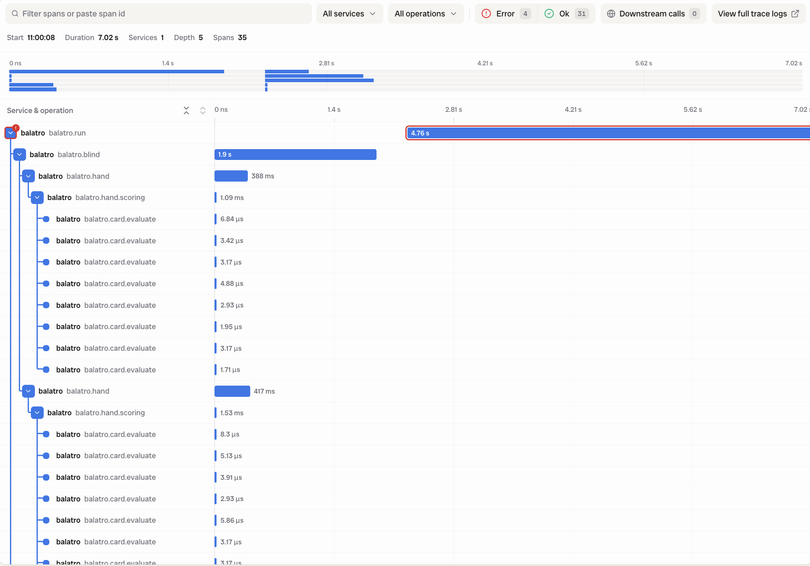

I should start this blog post with a witty joke, because that's one of the key ingredients that make [Balatro](https://www.playbalatro.com/) such a beloved game. However, I can't come up with one, so here's a different intro: I am fascinated by the possibility that any software I use could, in theory, emit logs, metrics and traces through [OpenTelemetry](https://opentelemetry.io/). And Balatro is software that I **use** a lot. I've spent hundreds of hours with it, the best 2 &times; 10 euros I've ever spent[^1]. So creating OpenTelemetry for Balatro was a side project I wanted to try out for a long time! I wanted to see if I could store my runs as traces and maybe even enable some troubleshooting. It turned out to be one of those projects where I cared more about the outcome than about writing the code myself, so it was a perfect candidate to ask an LLM to build for me!

I understand that you are not keen to read about yet another piece of software that AI generated, so if I lose you as a reader at this point, that's totally fine, you might enjoy this [piece here](https://svrnm.com/blog/what-is-contaxt-propagation-why-do-i-need-it/) more!

If you are keen to read on, you might be wondering why Balatro can be instrumented at all. First, it's built with [LÖVE](https://love2d.org/) and written in [Lua](https://www.lua.org/), and a modding framework, [Steamodded](https://github.com/Steamodded/smods), already exists. Second, the game is "transactional": you play hands, they get scored, you buy things in a shop, and so on. So "traces" make sense, which is not the case for all games. Based on that, an LLM can follow the OpenTelemetry specification, use [good skills](https://github.com/ollygarden/opentelemetry-agent-skills) and [Weaver](https://github.com/open-telemetry/weaver) to build out an _instrumentation library_ for Balatro, which is available here: <https://github.com/svrnm/balatro-otel>

If you have Balatro installed on your machine, you can [follow the instructions](https://github.com/svrnm/balatro-otel#quick-start) and see for yourself! Send your traces to a backend, and you will get traces for your runs, blinds, hands, scoring, evaluations, shops and booster packs! And if you want automation to generate lots of telemetry, [BalatroBot](https://github.com/coder/balatrobot) can help you with that.

The repository provides instructions to set up [Jaeger](https://www.jaegertracing.io/), but of course, since it is OpenTelemetry, you can send your data to your preferred backend. Since it's where I work and since it lets me store the telemetry long term, I used [Bronto](https://bronto.io/) as my backend.

With the telemetry stored in a backend, you can start analyzing your play: which hands you play in which situation, how you spend your money, which boss blinds you struggle the most with. The bot sessions recorded 112 runs with 2,000 hands, of which 1,400 were Pairs. The boss blinds that ended the most runs were _The Mouth_ and _The Psychic_ (8 runs each), and _The Water_ was the hardest: the bot lost to it 7 out of 8 times.

However, observability data's primary use case is not to analyze, but troubleshooting. I wanted to be able to ask: "What would a game developer or mod author need when something goes wrong?" To answer it, besides errors and stack traces, the mod records janky frames, update and draw times, the length of the animation queue and other game properties. This way I was able to confirm that some known bugs are gone, like the Perkeo and Wheel of Fortune crash, which was fixed in 1.0.1o. I also ran into bugs in the tooling, like in [BalatroBot](https://github.com/coder/balatrobot/issues/233), where skip-opened tag packs are a dead zone. The most interesting one was a bug where blind scores didn't add up, because under bosses that block hands, like _The Psychic_, a blocked hand scored 0, but the blind still gained the points. This was [fixed in Steamodded](https://github.com/Steamodded/smods/pull/1441) already, but my setup pinned an older version, because [BalatroBot failed to start on more recent versions](https://github.com/coder/balatrobot/issues/244). Finally, [I reported another bug](https://github.com/coder/balatrobot/issues/243), where the BalatroBot's responses were cut off when they didn't fit the socket's send buffer, which broke it under load.

All in all, instrumenting Balatro or any game like it is not even a terrible idea. The data is useful for analyzing your own play or your bots' plays and beyond that, it can be used for finding bugs and testing. If you'd like to play around with it, check [the repository](https://github.com/svrnm/balatro-otel) and send me a message if you tried it out or if you found another game that you have instrumented!

[^1]: I bought the game on Steam first, but then figured out that having a version on my phone would allow me to play it everywhere, especially on trains and planes! It was a big lifesaver during KubeCon EU 2025, where I spent half a week in a hotel room, because I got sick on day one.